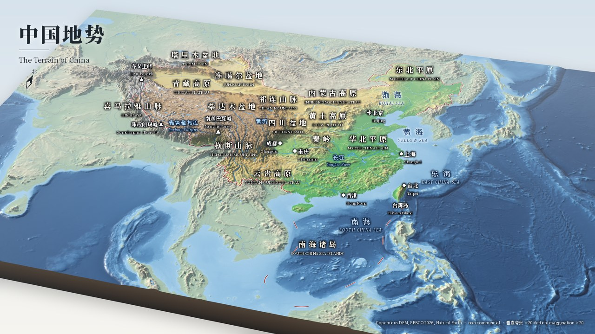
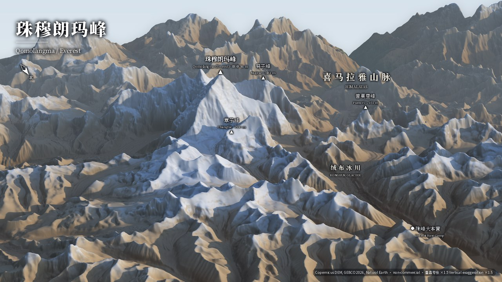
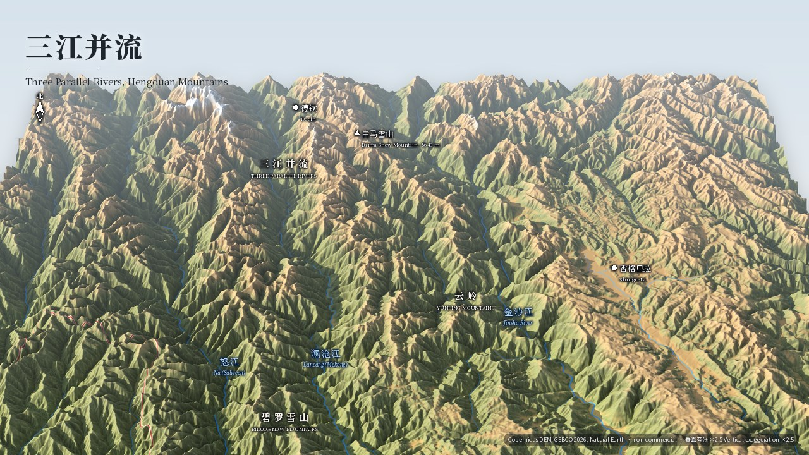
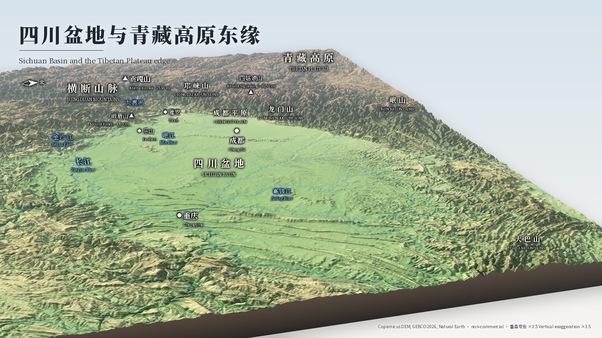
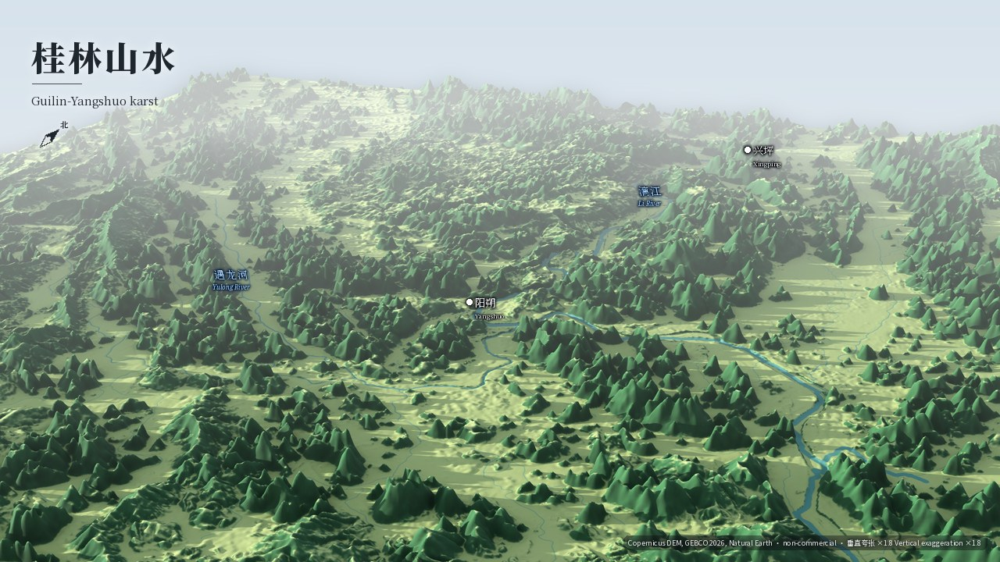
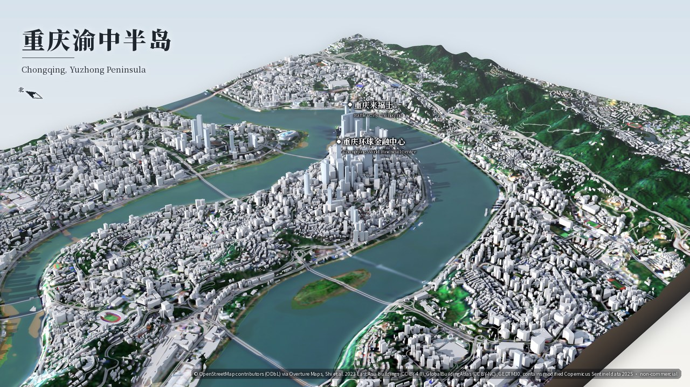
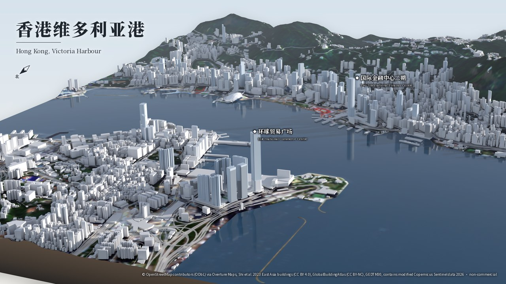

# china-terrain-maps · 中国地势三维图

**中文** 用开放数据制作的中国三维地势图：Blender Cycles 渲染的斜视立体地形图、可交互的 MapLibre 三维网页地图，以及重庆渝中半岛和香港维多利亚港的三维城市模型。

**English** Vivid oblique 3D terrain renders of China, an interactive MapLibre 3D web map, and 3D city
models of Chongqing (Yuzhong) and Hong Kong (Victoria Harbour), built entirely from open data. The look
follows the oblique relief maps of 星球研究所 and 中国国家地理.

> [!IMPORTANT]
> Boundaries follow the PRC point of view by choice. These are **not official standard maps** (no
> 审图号) and are **not intended for publication in mainland China**. See
> [Boundaries and disclaimer](#boundaries-and-disclaimer).

This is a personal, non-commercial project. The code is MIT ([LICENSE](LICENSE)). Rendered images, 3D
models and generated tiles are CC BY-NC 4.0 ([LICENSE-OUTPUTS.md](LICENSE-OUTPUTS.md)). Data credits
are in [ATTRIBUTION.md](ATTRIBUTION.md).

**Web map:** `https://xiejy.github.io/china-terrain-maps/` once GitHub Pages is enabled (see
[Deploying the web map](#deploying-the-web-map)).

## Gallery

Click an image to open the full 3840 × 2160 JPEG. Credits and the vertical exaggeration are printed
in the lower right of each image.

<a href="gallery/china.jpg"></a>

**中国地势 · The Terrain of China.** 1 km Copernicus DEM with GEBCO bathymetry, land ×20 and sea
floor ×4.4, seen from the south-south-east. China's border, the South China Sea dash line, Taiwan and the
South China Sea islands are drawn in full.

<table>
<tr>
<td width="50%"><a href="gallery/himalaya-everest.jpg"></a><br>
<b>珠穆朗玛峰 · Qomolangma / Everest.</b> The north face from the Tibetan side, with Changtse in front and the Rongbuk Glacier. 30 m GLO-30, ×1.5, 85 mm lens, low warm sun.</td>
<td width="50%"><a href="gallery/hengduan-three-rivers.jpg"></a><br>
<b>三江并流 · Three Parallel Rivers.</b> The Nu (Salween), Lancang (Mekong) and Jinsha (Yangtze) gorges, looking north. 90 m GLO-90, ×2.5, rivers traced from the DEM.</td>
</tr>
<tr>
<td><a href="gallery/sichuan-basin-tibet-edge.jpg"></a><br>
<b>四川盆地与青藏高原东缘 · Sichuan Basin and the Tibetan Plateau edge.</b> The Longmen–Qionglai wall rises out of the Chengdu Plain, seen from the east-south-east. 240 m, ×3.5.</td>
<td><a href="gallery/guilin-karst.jpg"></a><br>
<b>桂林山水 · Guilin–Yangshuo karst.</b> The Li River winds past Yangshuo through the karst towers, under a low sun and haze. 30 m GLO-30, ×1.8.</td>
</tr>
<tr>
<td><a href="gallery/city-chongqing-yuzhong.jpg"></a><br>
<b>重庆渝中半岛 · Chongqing, Yuzhong Peninsula.</b> 13,672 LoD1 buildings on GEDTM30 terrain, looking along the peninsula to Raffles City at Chaotianmen.</td>
<td><a href="gallery/city-hongkong-victoria-harbour.jpg"></a><br>
<b>香港维多利亚港 · Hong Kong, Victoria Harbour.</b> 11,954 buildings, looking from Kowloon (ICC in front) across the harbour to Central and the Peak.</td>
</tr>
</table>

## What's inside

### Terrain scenes ([config/scenes.yaml](config/scenes.yaml))

| scene | area (WGS84) | elevation data | DEM / texture grid | exaggeration |
|---|---|---|---|---|
| `china` | 70–140° E, 2–56° N, Albers equal-area | Copernicus GLO-30 (read at an overview) + GEBCO 2026 | 1000 m / 500 m | ×20 (sea floor 0.22 of that) |
| `himalaya-everest` | 86.45–87.30° E, 27.70–28.35° N | Copernicus GLO-30 | 30 m / 15 m | ×1.5 |
| `hengduan-three-rivers` | 98.2–100.2° E, 26.6–28.6° N | Copernicus GLO-90 | 90 m / 45 m | ×2.5 |
| `sichuan-basin-tibet-edge` | 100.5–108.5° E, 27.5–33.0° N | Copernicus GLO-30 (read at an overview) | 240 m / 120 m | ×3.5 |
| `guilin-karst` | 110.30–110.62° E, 24.65–24.95° N | Copernicus GLO-30 | 30 m / 10 m | ×1.8 |

Map labels (Chinese names over small English names) come from [config/labels.yaml](config/labels.yaml),
and the colour ramps from [config/palettes.yaml](config/palettes.yaml).

### 3D cities ([config/cities.yaml](config/cities.yaml))

| city | area | buildings | where the heights come from |
|---|---|---|---|
| `chongqing-yuzhong` | 106.53–106.61° E, 29.53–29.59° N (7.9 × 6.8 km) | 13,672 | GBA 7,835 · class default 5,511 · Overture floors 267 · Overture height 59 |
| `hongkong-victoria-harbour` | 114.135–114.19° E, 22.255–22.315° N (5.8 × 6.8 km) | 11,954 (+1,063 building parts) | Overture floors 5,154 · GBA 4,780 · class default 1,344 · Overture height 676 |

Each city is a glTF 2.0 model (terrain plus LoD1 buildings, Y-up, in metres), a meshopt-compressed web
copy of 5–6 MB, a GeoParquet of footprints with height and source, and a Blender render.

### Web map ([web/](web/README.md))

- **`index.html`** is a 3D terrain map of China built with MapLibre GL JS. It has colour relief (the
  render tints or a classic ramp), multidirectional hillshade, and 3D terrain with an exaggeration
  slider. You can toggle each layer and switch English names off. Buttons fly to the five scene
  viewpoints. A 南海诸岛 inset sits in the lower right, and a gallery lightbox opens at `#gallery`.
- **`city.html?c=<name>&view=map`** shows the city's buildings as extrusions coloured by height, on
  terrain. **`&view=3d`** opens the GLB in three.js with sun shadows.
- The site needs no server. Vector tiles are one PMTiles file. Elevation streams from Mapterhorn
  (`planet.pmtiles` on Source Cooperative), with AWS Terrain Tiles as the fallback (or `?dem=aws`).

### Repository layout

```text
config/            scenes, cities, palettes, labels (all tunables live here)
src/chinamaps/     Python package and chinamaps CLI: DEM assembly, tints, shading, textures,
                   city models, label compositing, web data; sources/ holds one reader per dataset
blender/           Cycles render scripts (run with .venv-blender), plus pure-numpy camera geometry
web/               Vite + TypeScript site (MapLibre, three.js); public/ holds the committed web data
gallery/           final renders: <name>.jpg (3840 px) and <name>_small.jpg (1280 px, re-labelled)
tests/             pytest suite (network tests are marked)
docs/              ARCHITECTURE.md: the file contracts between the pipeline stages
```

Downloads are cached under `data/` and build outputs go to `out/`. Neither is committed.

## Quick start

**You need:**
- Linux or macOS with [uv](https://docs.astral.sh/uv/).
- Python 3.13. The `bpy` 5.2 wheel is built for it.
- Node ≥ 22.12, for the web map and for `npx gltfpack` in city builds.
- About 3 GB of disk for caches and outputs.
- For final 4K renders, about 7 GB of free RAM.

Network access is plain HTTPS to:
- AWS S3: Copernicus DEM, Overture, and Source Cooperative.
- raw.githubusercontent.com: Natural Earth and Protomaps glyphs.
- fonts.gstatic.com.
- The npm registry.

```sh
git clone https://github.com/xiejy/china-terrain-maps && cd china-terrain-maps

# main stack: the chinamaps package and its pinned geo libraries (pyproject.toml)
uv venv .venv --python 3.13
uv pip install --python .venv/bin/python -e '.[dev]'

# Blender as a Python module, kept separate (no rasterio here: Blender reads .npy/.png/.json only)
uv venv .venv-blender --python 3.13
uv pip install --python .venv-blender/bin/python bpy==5.2.2 numpy==2.4.4 pillow==13.0.0 pyyaml==6.0.3

# GDAL, remote reads of Copernicus/GEBCO/Overture, a tiny Cycles render, headless WebGL2 -> out/smoke.json
.venv/bin/chinamaps smoke
```

The main stack pins numpy 2.4.4, rasterio 1.5.2 (GDAL 3.12), pyproj 3.8.0, shapely 2.2.0, geopandas
1.2.0, pyogrio 0.13.0, scipy 1.18.1, matplotlib 3.11.2, texshade 2.0, pyarrow 26.0.0, trimesh 5.1.1,
mapbox-earcut 2.1.0, pygltflib 1.16.5 and tippecanoe 2.72.0. The last smoke check (`chromium_webgl2`)
looks for a global Playwright install. Only the web screenshot test needs it.

### Build and render

```sh
# terrain scenes: china, himalaya-everest, hengduan-three-rivers, sichuan-basin-tibet-edge, guilin-karst
.venv/bin/chinamaps scene guilin-karst            # DEM + texture -> out/scenes/guilin-karst/
.venv/bin/chinamaps render guilin-karst --draft   # 1600x900, 32 spp -> out/renders/guilin-karst_draft_labeled.png
.venv/bin/chinamaps render guilin-karst           # 3840x2160, 128 spp -> gallery/guilin-karst.jpg + _small.jpg
.venv/bin/chinamaps annotate guilin-karst         # redo labels, title and credits without re-rendering

# 3D cities: chongqing-yuzhong, hongkong-victoria-harbour
.venv/bin/chinamaps city hongkong-victoria-harbour          # -> out/cities/hongkong-victoria-harbour/
.venv/bin/chinamaps render-city hongkong-victoria-harbour   # -> gallery/city-hongkong-victoria-harbour.jpg
.venv/bin/chinamaps annotate city-hongkong-victoria-harbour

# web data: vector tiles, viewpoints, city models, gallery copies -> web/public/
.venv/bin/chinamaps webdata
cd web && npm ci && npm run dev                   # http://localhost:5173 ; npm run build -> web/dist/
```

`render` and `render-city` take `--width`, `--height`, `--samples` and `--threads`. For look
development, call the Blender script directly. `--override` deep-merges JSON over the config:

```sh
.venv-blender/bin/python blender/render_scene.py out/scenes/china --draft --width 1280 --height 720 \
  --samples 16 --out /tmp/look.png --override '{"camera": {"azimuth": 150}, "exaggeration": 15}'
```

There are two kinds of scene key, both documented in the header of `config/scenes.yaml`:
- **Texture keys** (`palette`, `line_scale`, `river_*`, `border_*`) need `chinamaps scene <name>` to be
  run again.
- **Render keys** (camera, sun, `exaggeration`, `haze`, `grade`, `exposure_bias`, `dem_smooth_px`, …)
  take effect at the next render.

To add a scene, add an entry with `bounds`, `crs`, `dem`, `dem_res`, `texture_res`, `camera` and `sun`. To
label it, add features to `config/labels.yaml`.

Environment variables:
- `CHINAMAPS_DATA` moves the download cache (default `data/`).
- `CHINAMAPS_OUT` moves the outputs (default `out/`).
- `HTTPS_PROXY` is honoured.

### Tests

```sh
.venv/bin/python -m pytest -q -m 'not network' -k 'not end_to_end'   # 139 tests, about 4 s, no network
.venv/bin/python -m pytest -q                                        # all 146, incl. network and 2 Blender renders
cd web && npm run build && npm run screenshot                        # headless Chromium screenshots -> out/web/
```

## How it works

```text
TERRAIN SCENES
  Copernicus GLO-30/90 COGs ─┐  dem.py: read each 1° tile at the overview the scene needs (/vsicurl),
  GEBCO 2026 (15″, sea)  ────┤  mosaic, warp to the scene CRS, coastline from Natural Earth land,
  Natural Earth 1:10M ───────┘  GEBCO depths feathered off the coast             → dem.npy, mask.png
                                         │
            tint.py   Patterson cross-blended tints × smoothed climate mask, humid forest, snowline
            shade.py  MDOW hillshade (soft) + texture shading + gentle slope darkening
            texture.py  borders, South China Sea dashes, provinces, lakes, glaciers, rivers
                        (Natural Earth for China, traced from the DEM in close-ups)  → texture.png
                                         │  out/scenes/<name>/
            blender/render_scene.py  DEM mesh × exaggeration with a skirt, sun + physical sky,
                        Cycles 128 spp + OpenImageDenoise, mist-pass haze, colour grade
                                         │  out/renders/<name>.png + label screen positions
            annotate.py  CJK labels, title, north arrow, credits     → gallery/<name>.jpg, _small.jpg

3D CITIES
  Overture buildings, parts, roads, water ─┐  city.py: footprints → height cascade → LoD1 extrusions
  GlobalBuildingAtlas LoD1 (heights) ──────┤  set on the terrain; ground texture = Sentinel-2
  GEDTM30 bare-earth DTM (30 m) ───────────┤  + water + roads → city.glb, city_web.glb (gltfpack),
  Sentinel-2 quarterly mosaic (10 m) ──────┘  buildings.geoparquet            → out/cities/<name>/
            blender/render_city.py → annotate.py                → gallery/city-<name>.jpg

WEB MAP
  Natural Earth (China view) + labels.yaml ─► webdata.py (tippecanoe) ─► web/public/data/china.pmtiles
  out/cities/<name>/ ─────────────────────► webdata.py ──────────────► web/public/cities/
  gallery/ ───────────────────────────────► webdata.py ──────────────► web/public/gallery/
  Mapterhorn planet.pmtiles | AWS Terrain Tiles (streamed in the browser) ─► MapLibre terrain + relief
```

The file contracts between these stages are in [docs/ARCHITECTURE.md](docs/ARCHITECTURE.md).

**Elevation: Copernicus DEM plus GEBCO.** Land heights come from the Copernicus GLO-30 and GLO-90 COG
tiles on AWS. Each tile is read at the internal overview closest to the scene's resolution, so the
whole of China at 1 km needs only 433 MB of tiles. The coastline comes from Natural Earth land, not
from the DEM. Sea depths come from the GEBCO 2026 grid (15″) and ramp in over 3 px off the coast, so
the shelf meets the shore cleanly.

**Relief shading.** The texture carries soft shading only, because Blender casts the real shadows:
- *Multidirectional oblique-weighted (MDOW) hillshade*, as in `gdaldem -multidirectional`: four lights
  at 225°, 270°, 315° and 360°, weighted by aspect, so every ridge has a lit side.
- *Texture shading*: Leland Brown's fractional Laplacian (via `texshade`, α = 0.7), blended soft-light.
  It brings out the ridge-and-drainage hierarchy at every scale.

**Hypsometric tints.**
- *Lowlands*: cross-blended tints after Tom Patterson and Bernhard Jenny. Three lowland ramps (arid,
  warm humid and cold humid) are blended by a climate mask smoothed over about 150 km, so the Tarim
  Basin is ochre while the Sichuan Basin is green.
- *Uplands*: above 1000 m all regions share one ramp.
- *Snow and forest*: a snowline that varies with latitude and aspect adds snow, and humid slopes get
  darker forest.
- *Sea*: depths have their own blue ramp.
- *Overrides*: each scene can override any part of the palette.

**Rivers and boundaries.** Vectors are burned into the texture in tiles with matplotlib Agg, in global
pixel coordinates so tiles join without seams:
- *Rivers*: the national map uses Natural Earth rivers. The close-ups trace rivers from the DEM itself,
  so the blue lines sit in the valley floors.
- *Boundaries*: drawn with a halo. China's border and the dash line are drawn heavier than the rest.

**Blender Cycles oblique rendering.** Each scene's DEM becomes a real mesh, decimated to at most 2048
vertices along its longest side (2600 for China), and closed with a skirt.
- *Lighting*: a sun lamp sets the shadows and a physical sky adds a cool fill.
- *Camera*: placed by compass azimuth, elevation and focal length. It can fit a chosen region (for
  China, the hull of the mainland plus the dash line) instead of the whole slab.
- *Exposure*: calibrated so that flat ground shows its texture colour.
- *Rendering*: Cycles runs on the CPU at 128 samples with OpenImageDenoise. The mist pass adds aerial
  perspective (haze), and a saturation and contrast grade finishes the image.
- *Labels*: Blender projects the label anchors to the screen and tests them for occlusion. Python then
  composites them in Noto Serif SC. Water names are in left-slanted type, as in GB/T 20257, and a
  north arrow and credits are added.

**3D cities: Overture plus GlobalBuildingAtlas.** The footprints come from Overture Maps: mostly
OpenStreetMap, plus Shi et al.'s machine-learned buildings for East Asia. Each building takes the first
height it can find:
1. Overture `height`
2. Overture `num_floors` × 3.2 m
3. the height of the GlobalBuildingAtlas LoD1 footprint that overlaps it best (at least 50 % overlap)
4. a default by class and size

Where OSM is thin (Chongqing), GBA footprints replace the machine-learned ones that match the imagery
less well. Specks under 30 m² and small non-OSM footprints under green canopy are dropped.

Buildings stand on the GEDTM30 bare-earth terrain. The ground texture is the Sentinel-2 quarterly
cloudless mosaic for the quarter with the least haze and fewest gaps, upsampled to 2 m. Overture water
and roads are painted onto it. The web copy is compressed with gltfpack (meshopt) to under 8 MB.

## Measured sizes and timings

These were measured on the machine that made the gallery: 4 CPUs and 15 GB of RAM, shared with other
jobs, so times can vary by about 2× with load.

**Final renders:** 3840 × 2160, 128 samples, Cycles CPU, 4 threads.

| render | wall time | peak RAM |
|---|---|---|
| `china` | 683 s | 6.8 GB |
| `himalaya-everest` | 1742 s (ran alongside the web screenshot suite) | 5.8 GB |
| `hengduan-three-rivers` | 1100 s | 5.7 GB |
| `sichuan-basin-tibet-edge` | 632 s | 6.1 GB |
| `guilin-karst` | 690 s | 5.5 GB |
| `city-chongqing-yuzhong` | 924 s | 6.4 GB |
| `city-hongkong-victoria-harbour` | 984 s | 6.0 GB |

**Builds**, with a warm download cache:
- `chinamaps scene`: china 443 s; everest 49 s; hengduan 40 s; sichuan 53 s; guilin 24 s.
- `chinamaps city`: Chongqing 33 s; Hong Kong 23 s.
- `chinamaps webdata`: about 25 s.

**Download cache (`data/`, 1.3 GB):**

| source | size | what |
|---|---|---|
| Copernicus DEM | 687 MB | 3,681 GLO-30 tiles at 225 px/° for China (433 MB), 127 at 450 px/° for Sichuan (72 MB), 5 at full 1″ resolution for Everest and Guilin (148 MB), 9 GLO-90 tiles for Hengduan (33 MB) |
| GEBCO 2026 | 141 MB | one window (44–166° E, 7° S–61° N) at 60 and 120 px/° |
| Natural Earth 5.1.2 | 134 MB | 16 GeoJSON layers at 1:10M |
| city extracts | 282 MB | mostly the 2 m Sentinel-2 RGB arrays (159 MB and 118 MB). Each Overture and GBA extract is 0.1–3.8 MB, row-group-pruned from GeoParquet over HTTP |
| fonts | 63 MB | Noto Serif SC / Noto Sans SC / Noto Serif TTFs for the labels |

**Build outputs (`out/`, 1.4 GB):**
- `scenes/` is 822 MB. Most of it is China at 549 MB: a 6273 × 8592 DEM and a 12546 × 17184 texture.
- `cities/` is 287 MB. The full-resolution GLBs are 138 MB (Chongqing) and 110 MB (Hong Kong).
- `renders/` is 217 MB.

**Committed:**
- `gallery/` is 12 MB: 14 JPEGs of 1.0–1.8 MB at 3840 px and 0.2–0.3 MB at 1280 px.
- `web/public/` is 27 MB:
  - `china.pmtiles`: 5.5 MB.
  - City GLBs: 6.2 MB and 5.0 MB.
  - Building PMTiles: 1.8 MB and 1.6 MB.
  - Gallery copies: 5.5 MB.
  - Glyphs: 1.2 MB.
- The built site is 29 MB.

## Limitations

**Elevation data**
- **DEM sources.**
  - *Scenes*: Copernicus DEM on land and GEBCO at sea. GEBCO's 15″ grid (about 460 m) is enough for the
    national view. In many areas, though, it is interpolated between sparse soundings, so parts of the
    sea floor are smoother than they really are. The close-up scenes are inland and show no sea.
  - *Cities*: GEDTM30, a 30 m machine-learned bare-earth model, resampled to a 5 m mesh. Cliffs,
    embankments and river banks come out rounded. The harbour and rivers are flat, with no bathymetry.
  - *Web map*: Mapterhorn by default. It has no bathymetry (the sea is exactly 0 m), so seas are drawn
    flat. Turn on the AWS Terrain Tiles fallback to see the sea floor. Those tiles are built from older
    and coarser SRTM, GMTED2010 and ETOPO1 data.
- **Copernicus DSM epoch.** The Copernicus DEM is a surface model built from TanDEM-X radar data
  acquired around 2011–2015. The AWS copy is the 2021 release.
  - Forest canopy and buildings are part of the "ground", so city areas carry bumps.
  - Reservoirs filled and terrain reshaped since then are not shown.
  - The city models use GEDTM30 instead, so buildings are not counted twice.
- **30 m is too coarse for karst.** Even with sharpening, the Guilin towers render as steep cones, not
  sheer fenglin pillars.

**City models**
- **Machine-learned footprints in Chongqing.** OpenStreetMap covers few Chongqing buildings. Of the
  23,052 Overture buildings in the area, 19,986 are machine-learned footprints from Shi et al. 2023, and
  none of those carries a height.
  - The build swaps in GBA footprints where they fit the imagery better, and drops specks and canopy
    false positives (1,095 removed).
  - The final model mixes 5,503 GBA, 5,186 Shi et al. and 2,983 OSM footprints.
  - 40 % of the heights (5,511) are class and size defaults: 30 m residential, 45 m commercial and
    21 m otherwise.
- **LoD1 flat roofs.** Every building is a flat-roofed extrusion with one off-white material, and tall
  towers are only tinted toward glass. Building parts (podium plus tower) appear only where OSM maps
  them: 28 in Chongqing and 1,063 in Hong Kong.
- **GBA height saturation.** GlobalBuildingAtlas heights saturate at about 165–200 m. Supertall towers
  keep their full height only when OSM records a height or a floor count.
  - Hong Kong has good OSM coverage, so ICC stands at 484 m.
  - In Chongqing, only 59 heights and 267 floor counts are known, so many towers come out too short.
- **Ground imagery.** The ground is 10 m Sentinel-2 imagery upsampled to 2 m, so it looks soft up
  close. Harbour water is tinted flat to hide smeared boats.

**Maps and labels**
- **Boundaries** come from Natural Earth at 1:10M and are generalised.
  - The China–Nepal line misses the Everest summit by more than 1 km at 30 m scale, so the Everest scene
    draws no borders.
  - The dash line has 9 dashes. The tenth dash east of Taiwan on the current PRC standard map is not
    drawn, because no authoritative digitisation was reachable.
- **Labels** are hand-placed in `config/labels.yaml`. Some anchors are approximate (`approx: true`).
  Where labels would collide, a few are dropped; in the national render the only one dropped is 台湾岛,
  while 台北 and 玉山 are placed.

## Deploying the web map

The site is static. `.github/workflows/pages.yml` builds `web/` with Node 22 (`npm ci`, then `npm run
build`) on every push to `main` and deploys `web/dist` to GitHub Pages.

1. Push the repository to GitHub (`xiejy/china-terrain-maps`).
2. Open **Settings → Pages → Build and deployment** and set **Source** to **GitHub Actions**.
3. Re-run the `pages` workflow from the **Actions** tab (it also has a manual trigger), or push again.
4. The site is served at `https://xiejy.github.io/china-terrain-maps/`. Vite's relative base (`./`) makes
   it work under the project subpath. City pages are at `city.html?c=<name>&view=map|3d`.

CI runs no Python, so everything the site reads must be committed under `web/public/`. After changing a
config, a city or a render, run `chinamaps webdata`, then commit `web/public/` and `gallery/`. The
largest file is 6.2 MB, far below GitHub's 100 MB limit. Elevation tiles are not hosted here: the
browser streams them from Source Cooperative and AWS, which both send `Access-Control-Allow-Origin: *`.
To check the build locally under the project subpath, see the screenshot test in
[web/README.md](web/README.md).

## Boundaries and disclaimer

**English.** By choice, boundaries follow the point of view of the People's Republic of China.
- *Source*: Natural Earth's China point-of-view admin-0 layer, with mainland China, Hong Kong, Macau and
  Scarborough Shoal (Huangyan Island) merged into one China.
- *Dash line*: Natural Earth's China-view South China Sea maritime indicator (9 dashes).
- *What this means*: Taiwan is drawn and labelled as part of China, and disputed areas are drawn as
  the PRC claims them (for example Zangnan / Arunachal Pradesh and Aksai Chin).

This is a cartographic choice for the project, not a statement on any dispute.

**These are not official standard maps.** They have not been through the map review that publication
in mainland China requires, and they carry no review number (审图号). They are **not intended for
publication in mainland China**. They are generalised, so do not use them for navigation or for legal
or administrative purposes.

**中文 · 边界与免责声明** 本项目的国界按中华人民共和国的立场绘制，这是作者的选择。
- *数据来源*：Natural Earth 中国视角国界图层，并把香港、澳门、黄岩岛与中国合并。
- *断续线*：南海断续线采用 Natural Earth 的中国视角海上界线（9 段）。
- *具体表现*：台湾按中国领土绘制和标注。

本项目的地图**不是标准地图**，未经地图审核，**没有审图号**，**不用于在中国大陆公开出版、展示或传播**。地图经过概括，不得用于导航、法律或行政用途。

## Licence and attribution

- **Code** (`src/`, `blender/`, `web/src/`, `tests/`, `config/`): MIT, see [LICENSE](LICENSE).
- **Outputs** (rendered images, GLB models, generated tiles): CC BY-NC 4.0. The OpenStreetMap-derived
  building geometry is also under ODbL. See [LICENSE-OUTPUTS.md](LICENSE-OUTPUTS.md).
- **Data credits**: [ATTRIBUTION.md](ATTRIBUTION.md). In short:

  > Copernicus DEM © DLR e.V. 2010–2014 and © Airbus Defence and Space GmbH 2014–2018, provided under
  > COPERNICUS by the European Union and ESA · GEBCO Compilation Group (2026) GEBCO 2026 Grid · GEDTM30
  > (OpenGeoHub, CC BY 4.0) · Made with Natural Earth · © OpenStreetMap contributors (ODbL), Overture Maps
  > Foundation · Shi et al. 2023 East Asia buildings (CC BY 4.0) · GlobalBuildingAtlas (TUM, CC BY-NC 4.0)
  > · Contains modified Copernicus Sentinel data 2025–2026 · Mapterhorn · AWS Terrain Tiles
